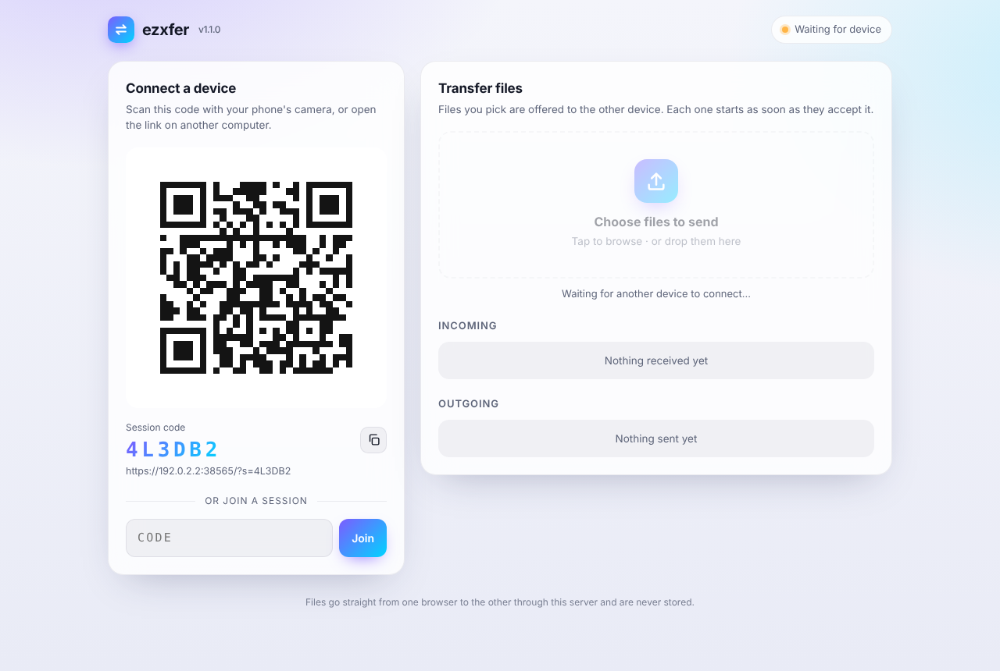
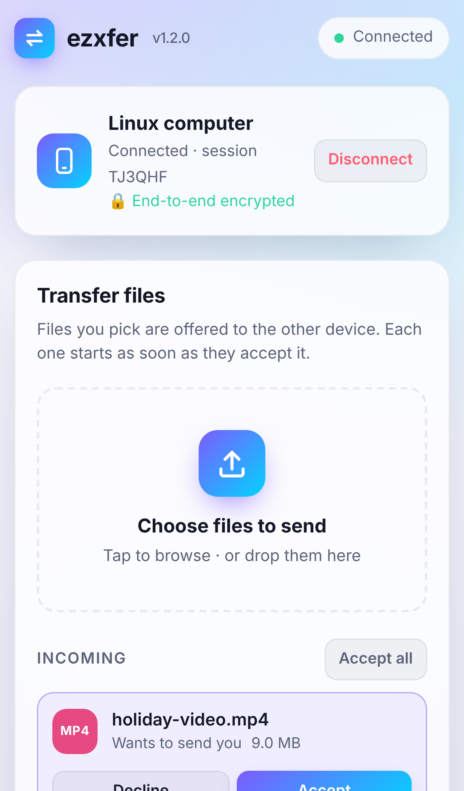
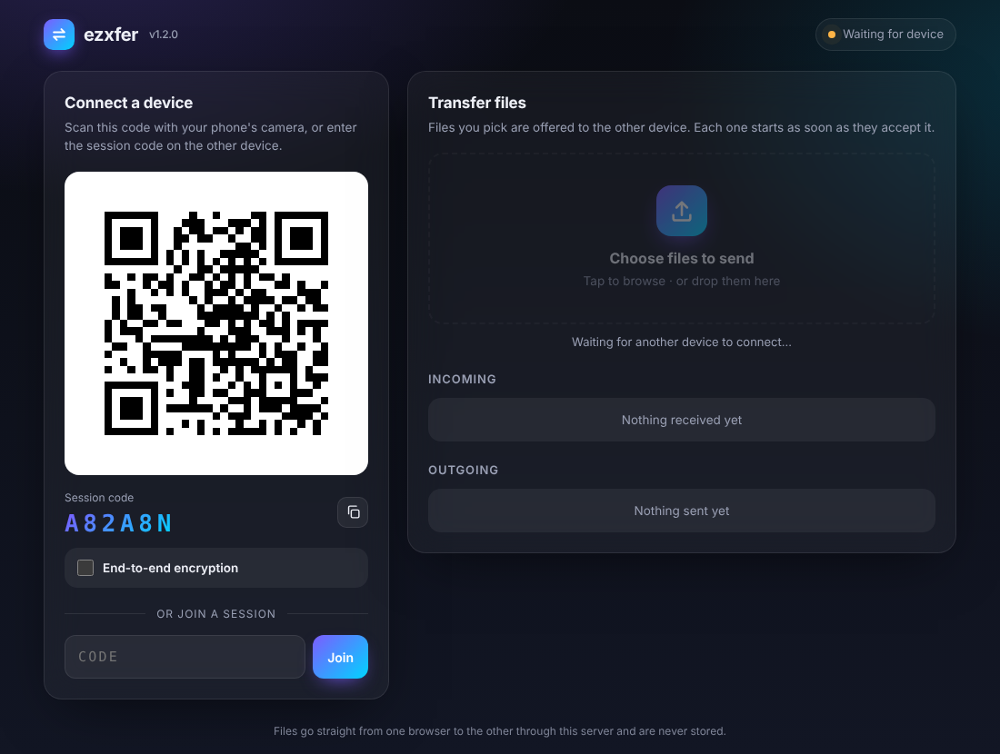

# ezxfer

Send files between a computer and a phone (or any two devices) from the browser.
Open the page, scan the QR code, then pick files on either side.

`ezxfer` is a single C program with no required dependencies (libc and POSIX sockets only; OpenSSL optionally, for HTTPS) containing:

- a small HTTP/1.1 server and a WebSocket (RFC 6455) server, with its own SHA-1 and Base64
- a QR code encoder (versions 1–40, all error-correction levels) that serves the code as SVG
- the web app (`web/index.html`), compiled into the binary at build time

| Desktop | Phone | Dark mode |
|---|---|---|
|  |  |  |

## Build & run

```sh
make
./ezxfer            # listens on 0.0.0.0:8080, plain HTTP
```

`make` links OpenSSL when it is installed (detected with `pkg-config`), which makes the `--cert`/`--key` options available. `make TLS=0` builds the fully dependency-free binary instead, and `make TLS=1` requires OpenSSL. `./ezxfer --help` tells you which kind of build you have.

On startup it prints the URLs and a QR code in the terminal. Open `http://localhost:8080` on the computer and scan the QR code shown on the page with your phone.

```
Options:
  -p, --port PORT    TCP port to listen on (default 8080)
  -b, --bind ADDR    IPv4 address to bind (default 0.0.0.0)
  -u, --url URL      public base URL encoded in QR codes
                     (default: http://<lan-ip>:<port>)
  -w, --web FILE     serve FILE as the page template instead of the
                     built-in one ({{VERSION}} is substituted)
  -c, --cert FILE    serve HTTPS using this PEM certificate (chain);
                     without it the server speaks plain HTTP
  -k, --key FILE     PEM private key for --cert (default: read the
                     key from the --cert file)
  -t, --session-timeout SECONDS
                     how long a session waits for its devices to
                     reconnect after both dropped (default 120)
      --no-qr        don't print a QR code in the terminal
  -q, --quiet        no banner or logging
```

Builds with gcc or clang on Linux and macOS.

## HTTPS (optional)

The server speaks plain HTTP unless you give it a certificate:

```sh
./ezxfer --cert cert.pem --key key.pem
```

With a certificate, the same port serves HTTPS and secure WebSockets (WSS), and the QR code links to `https://…`. A plain `http://` request to that port is redirected to `https://`. `--cert` takes a PEM certificate or a full chain (leaf first). If the private key is in the same file, `--key` can be omitted. The server only accepts TLS 1.2 or newer.

HTTPS also gives desktop Chrome/Edge on other machines the native **Save as** dialog, because that needs a secure context.

**Getting a certificate the phone trusts.** The phone checks the certificate against the address in the QR code, which is usually your LAN IP. There are two options:

- **Recommended: [mkcert](https://github.com/FiloSottile/mkcert).** It creates a local certificate authority. Install its root CA on the phone once (on iOS, also enable it under *Settings → General → About → Certificate Trust Settings*). After that, certificates it issues are trusted without warnings:
  ```sh
  mkcert -install
  mkcert -cert-file cert.pem -key-file key.pem 192.168.1.20 localhost 127.0.0.1
  ```
- **Quick self-signed certificate.** Browsers show a warning that you have to click through on each device:
  ```sh
  openssl req -x509 -newkey ec -pkeyopt ec_paramgen_curve:P-256 -nodes -days 365 \
    -subj /CN=ezxfer -addext "subjectAltName=IP:192.168.1.20,DNS:localhost" \
    -keyout key.pem -out cert.pem
  ```
  Some browsers, notably Safari, may refuse the WebSocket connection to an untrusted certificate even after you accept the page warning. If the page loads but never says "Waiting for device", use a trusted certificate instead (mkcert).

  Chrome also refuses service workers on a site whose certificate it doesn't trust, so with a clicked-through self-signed certificate, downloads on Android fall back to collecting the file in memory. Large downloads to an Android phone need a trusted certificate (mkcert).

## How it works

1. Opening the page connects a WebSocket to `/ws`. The server creates a **session** with a random 6-character code and replies with a join URL like `http://192.168.1.20:8080/?s=K7PQ2M`. The page shows that URL as a QR code (`/qr.svg?d=…`).
2. The phone opens that URL and connects to `/ws?s=K7PQ2M`, which joins the session. Each session holds two devices; a third is turned away. You can also type the code into the **Join** box on another computer.
3. Picking files sends an *offer* (name, size, type) to the peer, where it shows up with **Accept / Decline**. When the receiver accepts and picks where to save, the sender starts streaming. The data goes as 256 KB binary WebSocket messages, and the server relays each one to the other device unchanged.
4. Where to save:
   - Browsers with the File System Access API (desktop Chrome/Edge over `localhost` or HTTPS) show a native **Save as** dialog and write straight to disk.
   - Otherwise, on HTTPS (or `localhost`), Android and desktop Firefox stream the file into the browser's normal download through a small service worker (`/sw.js`), so it never sits in memory. The worker answers a hidden `/dl/…` request with a streaming response that the page feeds chunk by chunk. Backpressure from the download reaches all the way back to the sender.
   - Everywhere else (plain-HTTP LAN pages, and iOS, whose WebKit doesn't reliably download such streams), the file is collected in memory and then handed to the browser's normal download.

Files are relayed, never stored. Flow control works end to end:
- The sender limits its WebSocket buffer and the amount of data the receiver hasn't acknowledged yet.
- The server stops reading from a sender once that sender's peer has more than 4 MB of output queued.

Memory therefore stays bounded however large the file is.

**Dropped connections resume.** Each page has a random client id, which it sends when connecting.
- If a device's connection drops, for example a phone that loses Wi-Fi or locks its screen, transfers on both sides pause.
- When the device reconnects with the same id, it takes back its slot in the session. This works even if the server hasn't yet noticed that the old connection died.
- The receiver then tells the sender which byte to continue from.
- Every data chunk carries its byte offset, so chunks left over from before the drop are discarded instead of being written in the wrong place.
- If both devices drop, the session waits `--session-timeout` seconds (default 120) for them to return.
- Reloading the page starts over, because the browser can't keep the selected file or the partial download across a reload.

The join URL uses the address the page was opened with. If that was `localhost`, the server substitutes the machine's LAN IPv4 address. Use `--url` when running behind a reverse proxy or NAT.

### Limits and notes

- By default traffic is plain HTTP; use `--cert`/`--key` to encrypt it (see above). Behind a TLS reverse proxy such as Caddy or nginx, run ezxfer without a certificate and pass `--url https://…`.
- Anyone who knows a session's code can join it while it has a free slot. Codes are random (32⁶ ≈ 10⁹ combinations), and a session is full once two devices are connected.
- While a transfer is running, the page keeps the screen on with the Screen Wake Lock API, because phones drop network connections when the screen locks. Browsers only offer this on HTTPS (or `localhost`); elsewhere, phones show a hint to keep the screen on.
- Only the in-memory route (plain HTTP, or iOS) holds the whole file in memory until the transfer completes. That is fine for photos and videos, but very large files (several GB) on a phone may hit browser limits. To receive big files on an Android phone, run with `--cert`/`--key` so downloads are streamed.

## Layout

```
src/main.c      command line parsing
src/server.c    poll() event loop, HTTP routes, sessions, WebSocket relay
src/proto.c     HTTP request parser, query decoding, WebSocket framing
src/tls.c       optional OpenSSL wrapper (stubs when built with TLS=0)
src/sha1.c      SHA-1 + Base64 (WebSocket handshake)
web/sw.js       service worker that streams received files into downloads
src/qr.c        QR code encoder + SVG output
web/index.html  the frontend (embedded via tools/embed.c, like sw.js)
tests/          unit, QR reference, integration and browser tests
```

## Tests

```sh
make test-unit          # C unit tests under ASan/UBSan
make test-qr            # QR output vs. python-qrcode, bit for bit, plus jsQR decoding
make test-integration   # black-box HTTP/WebSocket tests (Python stdlib only)
make test-e2e           # two real Chromium pages (desktop + emulated iPhone)
make test-integration-tls test-e2e-tls   # the same two suites over HTTPS/WSS
make test               # all of the above (TLS suites when built with TLS)
```

The TLS suites also need the `openssl` command to generate a throwaway certificate. The test-only dependencies are `pip install qrcode` and `cd tests && npm install` (Playwright, jsQR). The program itself has no dependencies.

What is covered:

- **Unit:** SHA-1/Base64 test vectors, the RFC 6455 handshake and framing examples, all payload-length encodings, protocol-error handling, HTTP parsing, query decoding, and the QR capacity table, structure and SVG output.
- **QR:** about 190 symbols across versions 1–40, all ECC levels and all masks, matched module for module against python-qrcode and decoded by jsQR.
- **Integration:**
  - routes and error statuses
  - session create/join/full/not-found, peer leave and rejoin
  - relay of text, binary and fragmented messages; ping/pong; protocol violations
  - a 64 MB transfer with integrity check
  - backpressure: a stalled receiver throttles the sender and server memory stays flat
  - command-line options and the terminal QR code
- **TLS:** the integration and browser suites run in full over HTTPS/WSS, with the client verifying the certificate. Extra TLS tests cover:
  - the http→https redirect and the negotiated protocol version
  - clients that don't trust the certificate, garbage and abandoned handshakes
  - a combined certificate+key PEM file
  - mismatched or invalid PEM files, which are refused at startup
- **E2E:**
  - the page's QR code scans to the join URL, and an emulated iPhone joins with it
  - transfers in both directions, using both save paths, with byte-for-byte checks
  - empty files, several files at once, decline, cancel from either side
  - disconnect and rejoin, joining by typed code, a third device being refused, a stale link
  - reconnecting after a server restart, and the responsive layout
